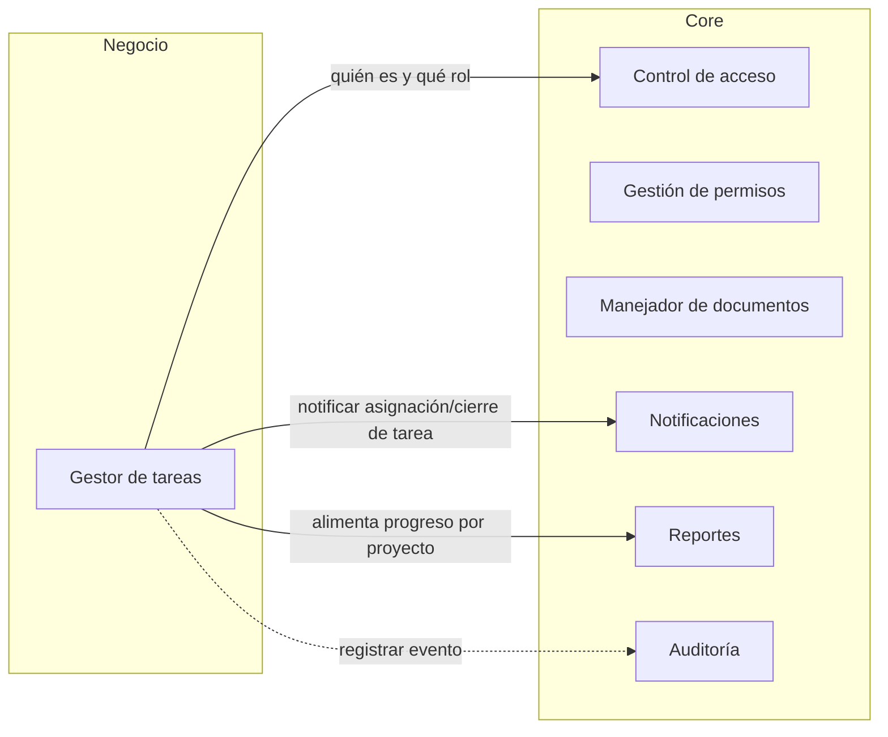
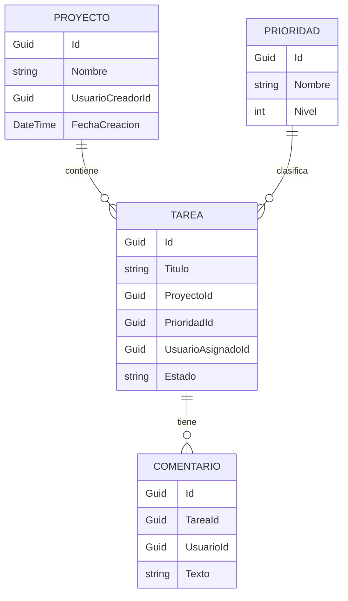

# GestorTareasP3
Gestor de tareas por proyecto: organiza las tareas por proyecto y prioridad, con vista de progreso. Proyecto de Programación III.
## Arquitectura de componentes



## Entidades del módulo de negocio



## Contenedor

Los comandos de esta sección son para Windows PowerShell 5.1.

### 1. Requisitos

Solo necesitas Git y Docker Desktop encendido. No hace falta instalar .NET ni SQL Server.

### 2. Levantar el proyecto

Clona el repositorio, entra en la carpeta, copia el archivo de entorno y levanta el contenedor:

```powershell
git clone <URL_DEL_REPOSITORIO>
Set-Location GestorTareasP3
Copy-Item .env.example .env
docker compose up --build
```

La primera vez tarda unos minutos. SQL Server tarda cerca de 40 segundos en estar listo.
La API responde en `http://localhost:5065`. Comprueba que `http://localhost:5065/salud`
responde `OK`.

### 3. Detenerlo

```powershell
docker compose down
```

Este comando conserva la base y los documentos en los volúmenes con nombre
`sqlserver-datos` y `documentos-datos`. Para empezar de cero y borrar todos los datos:

```powershell
docker compose down -v
```

Usa `docker compose down -v` solo para empezar de cero.

### 4. Administrador inicial

El Administrador se crea al arrancar con los valores del `.env`:
`admin.ejemplo@example.com` y `Cambiar_Esta_Clave_123`.

### 5. Correos sin SMTP real

Con el `.env.example` el SMTP es de ejemplo, así que los correos no salen, pero cada uno
queda guardado en la tabla `CorreosEnCola`. Define esta función para leer el último correo
de activación de cuenta o código de recuperación, y copia el enlace o el código:

```powershell
function UltimoCorreo {
  docker compose exec sqlserver sh -c '/opt/mssql-tools18/bin/sqlcmd -C -S localhost -U sa -P \"$MSSQL_SA_PASSWORD\" -d GestorTareas -y 0 -Q \"SET NOCOUNT ON; SELECT TOP 1 Cuerpo FROM CorreosEnCola ORDER BY FechaCreacion DESC\"'
}
```

Para probar el flujo con un usuario nuevo, regístralo con `POST /api/registro`, ejecuta
`UltimoCorreo`, abre el enlace `/api/activar?token=...` y verifica que responde
«Cuenta activada correctamente».

Para recuperar la contraseña, ejecuta `POST /api/contrasena/recuperar`, usa `UltimoCorreo`
para ver el código y ejecuta `POST /api/contrasena/restablecer`.

### 6. Pruebas de los criterios con el contenedor

Las tablas «Cómo probar» de las secciones siguientes usan SSMS y `dotnet run` solo para
consultar la base. Con el contenedor, el endpoint `GET /api/usuarios` (como Administrador)
reemplaza a SSMS para ver quién está activo, y la función `Llamar` de la sección
«Activación de la cuenta» sirve igual.

### 7. Datos que sobreviven

Sube un documento, ejecuta `docker compose down` sin `-v`, levanta otra vez con:

```powershell
docker compose up
```

Comprueba que el documento sigue en el listado y se descarga, y que los usuarios
registrados pueden iniciar sesión.

### 8. Enviador opcional

Si pones un SMTP real en el `.env`, el Enviador envía los correos pendientes con:

```powershell
docker compose run --rm enviador
```

### 9. Clima

Sin una clave real en `CLIMA_API_KEY`, el resumen del proyecto responde `503` y el resto
del proyecto funciona. Consulta el detalle en «API externa».

## Cómo ejecutar

La forma principal de ejecutar el proyecto es la sección «Contenedor».

### Requisitos previos
- SDK de .NET 10.
- Docker Desktop, abierto y corriendo.
- Herramienta de migraciones de Entity Framework: `dotnet tool install --global dotnet-ef` (una sola vez).
- PowerShell (los comandos de este README son para Windows PowerShell).

### 1. Variables de entorno
Copia la plantilla y completa tus valores:

```powershell
Copy-Item .env.example .env
```

Abre `.env` y define:
- `MSSQL_SA_PASSWORD`: inventa una contraseña de 8 o más caracteres con mayúscula, minúscula, número y símbolo. Evita `$`, `;`, `=`, comillas y espacios.
- `ConnectionStrings__Default`: reemplaza `CAMBIAR_ESTO` en `Database` por `GestorTareas` y en `Password` por la misma contraseña de arriba.
- `SMTP_USUARIO` y `SMTP_REMITENTE`: tu cuenta de Gmail.
- `SMTP_CLAVE`: la contraseña de aplicación de esa cuenta, sin espacios.
- `SMTP_HOST`, `SMTP_PUERTO` y `SMTP_NOMBRE_REMITENTE` ya traen un valor útil en la plantilla.
- `APP_URL_BASE`: ya trae `http://localhost:5065` en la plantilla; cámbiala solo si usas otro puerto.
- `ADMIN_NOMBRE`, `ADMIN_CORREO` y `ADMIN_CLAVE`: los datos del Administrador inicial, que se crea al arrancar la API. La clave debe cumplir la política de contraseña (8 o más caracteres, con letras y números).

El archivo `.env` está en `.gitignore` y nunca se sube al repositorio.

| Nombre | Para qué sirve |
| --- | --- |
| `MSSQL_SA_PASSWORD` | Contraseña del usuario `sa` del SQL Server en Docker. La lee Docker Compose desde `.env`. |
| `ConnectionStrings__Default` | Cadena de conexión a la base `GestorTareas`. La usan la API y `dotnet ef`. |
| `SMTP_HOST` | Servidor SMTP. Con Gmail: `smtp.gmail.com`. |
| `SMTP_PUERTO` | Puerto SMTP con cifrado STARTTLS: `587`. |
| `SMTP_USUARIO` | Cuenta con la que el Enviador inicia sesión en el servidor SMTP. |
| `SMTP_CLAVE` | Contraseña de aplicación de esa cuenta. En Gmail se crea en `myaccount.google.com/apppasswords` y exige la verificación en dos pasos. Se escribe sin espacios. |
| `SMTP_REMITENTE` | Dirección que figura como remitente. Con Gmail, la misma cuenta de `SMTP_USUARIO`. |
| `SMTP_NOMBRE_REMITENTE` | Nombre que ve el destinatario en su bandeja, por ejemplo `Gestor de Tareas`. |
| `APP_URL_BASE` | Dirección base de la API, usada para armar el enlace de activación del correo. En local: `http://localhost:5065`. |
| `ADMIN_NOMBRE` | Nombre del Administrador inicial. Se crea al arrancar la API si no existe un usuario con el correo indicado. |
| `ADMIN_CORREO` | Correo del Administrador inicial. Si ya existe un usuario con este correo, no se modifica. |
| `ADMIN_CLAVE` | Contraseña del Administrador inicial. Debe cumplir la política de contraseña de RF-CA-14. |

.NET no lee el archivo `.env` por sí solo. En cada ventana de PowerShell nueva, antes de aplicar migraciones o ejecutar la API, carga las variables con:

```powershell
Get-Content .env | Where-Object { $_ -match '^\s*[^#=\s]+=' } | ForEach-Object { $n, $v = $_ -split '=', 2; [Environment]::SetEnvironmentVariable($n.Trim(), $v.Trim(), 'Process') }
```

### 2. Base de datos
```powershell
docker compose up -d
```
Espera unos 30 segundos a que SQL Server termine de arrancar. Luego crea la base y la tabla:

```powershell
dotnet ef database update --project src/GestorTareas.ControlAcceso
```
Luego crea la tabla de la cola de correos:

```powershell
dotnet ef database update --project src/GestorTareas.Notificaciones
```

Luego crea las tablas de Gestión de permisos y del módulo de negocio:

```
dotnet ef database update --project src/GestorTareas.GestionPermisos
dotnet ef database update --project src/GestorTareas.Negocio
```

Y crea las tablas del módulo de negocio:

```powershell
dotnet ef database update --project src/GestorTareas.Negocio
```

Si todavía no se han aplicado las migraciones de Gestión de permisos, ejecuta:

```powershell
dotnet ef database update --project src/GestorTareas.GestionPermisos
```

Para apagar la base sin perder los datos: `docker compose down`. No uses `docker compose down -v`, que borra el volumen con los datos.

### 3. Ejecutar la API
Con las variables cargadas en esta ventana:

```powershell
dotnet run --project src/GestorTareas.Api --launch-profile http
```

La API queda en `http://localhost:5065`. Verifica con `Invoke-RestMethod http://localhost:5065/salud`, que debe responder `OK`.

## Cómo probar los criterios

Abre **otra** ventana de PowerShell (la primera queda ocupada con la API) y define esta función de ayuda, que muestra el código de respuesta y el mensaje:

```powershell
$base = "http://localhost:5065"
function Probar($cuerpo) {
  try {
    $r = Invoke-WebRequest -Uri "$base/api/registro" -Method Post -ContentType "application/json" -Body $cuerpo -UseBasicParsing
    "$($r.StatusCode) $($r.Content)"
  } catch {
    $resp = $_.Exception.Response
    $texto = $_.ErrorDetails.Message
    if (-not $texto -and $resp) {
      try { $texto = (New-Object System.IO.StreamReader($resp.GetResponseStream())).ReadToEnd() } catch {}
    }
    "$([int]$resp.StatusCode) $texto"
  }
}
```

### Registro de usuario (RF-CA-01, RF-CA-02, RF-CA-14, RD-07)

| Criterio | Comando | Resultado esperado |
| --- | --- | --- |
| Registro válido | `Probar '{"nombre":"Prueba Uno","correo":"prueba1@example.com","contrasena":"Clave1234"}'` | `201` y "Cuenta creada correctamente." |
| Correo repetido (RF-CA-01) | El mismo comando de arriba otra vez | `409` y "Ya existe una cuenta con ese correo." |
| Contraseña corta (RF-CA-14) | `Probar '{"nombre":"Corta","correo":"corta@example.com","contrasena":"ab12"}'` | `400` y "La contraseña debe tener al menos 8 caracteres." |
| Contraseña sin número (RF-CA-14) | `Probar '{"nombre":"Letras","correo":"letras@example.com","contrasena":"SoloLetras"}'` | `400` y mensaje de que falta un número |
| Correo mal formado (RD-07) | `Probar '{"nombre":"Malo","correo":"esto-no-es-un-correo","contrasena":"Clave1234"}'` | `400` y "El correo no tiene un formato válido." |
| Objeto vacío (RD-07) | `Probar '{}'` | `400` con los errores de nombre, correo y contraseña obligatorios |
| JSON roto (RD-07) | `Probar '{"nombre": '` | `400` y "Los datos enviados no tienen un formato válido." |
| Tipo incorrecto (RD-07) | `Probar '{"nombre":123,"correo":"a@example.com","contrasena":"Clave1234"}'` | `400` y el mismo mensaje de formato |

Ningún mensaje contiene trazas, rutas ni consultas (RD-08).

### Hash con sal (RF-CA-02)
Registra un segundo usuario con la misma contraseña:

```powershell
Probar '{"nombre":"Prueba Dos","correo":"prueba2@example.com","contrasena":"Clave1234"}'
```

Conéctate con SSMS a `localhost,1433` (autenticación SQL Server, usuario `sa`, tu contraseña, marcando "Trust server certificate") y ejecuta:

```sql
USE GestorTareas;
SELECT Nombre, Correo, HashContrasena, Sal, Rol, Activo FROM Usuarios;
```

Resultado esperado: la contraseña no aparece en ninguna columna, `HashContrasena` y `Sal` son distintos para cada usuario aunque la contraseña sea la misma, y `Activo` vale `0` (la cuenta nace inactiva).

### Persistencia (RD-09)
Detén la API con Ctrl+C, vuelve a arrancarla y repite la consulta de SSMS: los usuarios siguen ahí.

## Correo saliente: la cola y el Enviador

Ninguna operación envía correos por sí misma. Cada correo se anota en la tabla `CorreosEnCola` con estado pendiente, y un programa aparte, el Enviador, toma los pendientes, los envía por SMTP y los marca como enviados. Así una operación termina bien aunque el servidor de correo no responda.

Carga las variables en la ventana de PowerShell (comando de «Variables de entorno») y ejecuta:

```powershell
dotnet run --project src/GestorTareas.Enviador
```

Imprime `Resumen: enviados N; fallidos M.` Si el correo no aparece en la bandeja, revisa la carpeta de spam.

### Cómo probar los criterios

El registro de usuarios encola solo el correo de activación. Para probar la cola por separado también puedes insertar un correo a mano:

```sql
USE GestorTareas;
INSERT INTO CorreosEnCola (Id, Destinatario, Asunto, Cuerpo, Estado, Intentos, FechaCreacion)
VALUES (NEWID(), 'TU_CORREO_AQUI', 'Prueba del Enviador', 'Hola, este es un correo de prueba.', 0, 0, SYSUTCDATETIME());
```

| Criterio | Cómo provocarlo | Resultado esperado |
| --- | --- | --- |
| El correo se envía de verdad (RF-NOT-09) | Ejecuta el Enviador | `enviados 1; fallidos 0.` y el correo llega, con remitente «Gestor de Tareas» |
| No duplica envíos (RF-NOT-12) | Ejecuta el Enviador otra vez | `enviados 0; fallidos 0.` y no llega nada |
| La operación no depende del servidor SMTP (RF-NOT-08) | Inserta otro correo, ejecuta `$env:SMTP_HOST = "servidor.invalido"` y corre el Enviador | `fallidos 1`. En SSMS, `SELECT Estado, Intentos, UltimoError FROM CorreosEnCola` muestra el correo con `Estado = 0` (pendiente) e `Intentos = 1` |
| El correo pendiente se entrega después | Restaura con `$env:SMTP_HOST = "smtp.gmail.com"` y vuelve a correr el Enviador | `enviados 1` y el correo llega |
| Sin credenciales en el repositorio (RF-NOT-13) | Quita `SMTP_CLAVE` del entorno y corre el Enviador | Mensaje con el nombre de la variable que falta, sin datos sensibles |

## Activación de la cuenta

Al registrarse, el usuario nace inactivo y recibe por correo un enlace con un token de un solo uso que vence en 24 horas. En la base solo se guarda el hash del token, nunca el token.

Con la API corriendo, define esta función de ayuda en otra ventana de PowerShell (sirve para todos los endpoints):

```powershell
$base = "http://localhost:5065"
function Llamar($metodo, $ruta, $cuerpo) {
  try {
    if ($cuerpo) { $r = Invoke-WebRequest -Uri "$base$ruta" -Method $metodo -ContentType "application/json" -Body $cuerpo -UseBasicParsing }
    else { $r = Invoke-WebRequest -Uri "$base$ruta" -Method $metodo -UseBasicParsing }
    "$($r.StatusCode) $($r.Content)"
  } catch {
    $resp = $_.Exception.Response
    $texto = $_.ErrorDetails.Message
    if (-not $texto -and $resp) { try { $texto = (New-Object System.IO.StreamReader($resp.GetResponseStream())).ReadToEnd() } catch {} }
    "$([int]$resp.StatusCode) $texto"
  }
}
```

Los correos los envía el Enviador (`dotnet run --project src/GestorTareas.Enviador`, con las variables cargadas). Si el correo no llega, revisa la carpeta de spam. Para probar con una sola cuenta de Gmail puedes usar variantes como `TU_CORREO+uno@gmail.com`: Gmail las entrega a la misma bandeja y la aplicación las trata como correos distintos.

### Cómo probar los criterios (RF-CA-15, RF-CA-16, RF-CA-17)

| Criterio | Cómo provocarlo | Resultado esperado |
| --- | --- | --- |
| La cuenta nace inactiva y el correo sale por la cola (RF-CA-15) | `Llamar Post "/api/registro" '{"nombre":"Ana","correo":"TU_CORREO+uno@gmail.com","contrasena":"Clave1234"}'` y luego `SELECT Correo, Activo FROM Usuarios` en SSMS | `201`; `Activo = 0`; un correo `Pendiente` en `CorreosEnCola` |
| Llega el enlace | Ejecuta el Enviador | `enviados 1`; el correo «Activa tu cuenta en Gestor de Tareas» llega con el enlace |
| Abrir el enlace activa la cuenta (RF-CA-16) | Abre el enlace en el navegador | `{"mensaje":"Cuenta activada correctamente."}`; en SSMS `Activo = 1` |
| El enlace es de un solo uso (RF-CA-16) | Abre el mismo enlace otra vez | `400` con «El enlace de activación no es válido o ya venció.»; el estado no cambia |
| El enlace vence (RF-CA-16) | Registra otro usuario, envía el correo y, antes de abrir el enlace, ejecuta en SSMS: `UPDATE Usuarios SET VencimientoActivacion = DATEADD(HOUR, -1, SYSUTCDATETIME()) WHERE Correo = 'TU_CORREO+dos@gmail.com'`. Luego abre el enlace | `400` con el mismo mensaje; `Activo` sigue en `0` |
| El reenvío invalida el enlace anterior (RF-CA-17) | Con un usuario inactivo: `Llamar Post "/api/activacion/reenviar" '{"correo":"TU_CORREO+tres@gmail.com"}'`, ejecuta el Enviador y abre primero el enlace **viejo** y después el **nuevo** | El viejo da `400`; el nuevo activa la cuenta |
| Respuesta idéntica exista o no el correo (RF-CA-17) | Reenvío con un correo inexistente y con uno ya activo | Los dos dan `200` con «Si el correo corresponde a una cuenta pendiente de activación, recibirás un nuevo enlace.» |
| Correo mal formado (RD-07) | `Llamar Post "/api/activacion/reenviar" '{"correo":"esto-no-es-un-correo"}'` | `400` con «El correo no tiene un formato válido.» |

Los enlaces de activación no aparecen en la consola de la API: el token viaja en la URL y se filtró de los logs (RD-08).

## Sesión

El inicio de sesión entrega un token que se envía en el encabezado `Authorization: Bearer <token>`. En la base solo se guarda el hash del token, nunca el token. La sesión dura 8 horas.

Con la API corriendo, define esta función de ayuda en otra ventana de PowerShell (acepta un token opcional para los endpoints protegidos):

```powershell
$base = "http://localhost:5065"
function LlamarSesion($metodo, $ruta, $cuerpo, $token) {
  $p = @{ Uri = "$base$ruta"; Method = $metodo; UseBasicParsing = $true }
  if ($cuerpo) { $p.ContentType = "application/json"; $p.Body = $cuerpo }
  if ($token) { $p.Headers = @{ Authorization = "Bearer $token" } }
  try {
    $r = Invoke-WebRequest @p
    "$($r.StatusCode) $($r.Content)"
  } catch {
    $resp = $_.Exception.Response
    $texto = $_.ErrorDetails.Message
    if (-not $texto -and $resp) { try { $texto = (New-Object System.IO.StreamReader($resp.GetResponseStream())).ReadToEnd() } catch {} }
    "$([int]$resp.StatusCode) $texto"
  }
}
```

Necesitas una cuenta activa. Regístrala y actívala con el enlace del correo (sección anterior), o, solo para probar, actívala directo en SSMS:

```sql
USE GestorTareas;
UPDATE Usuarios SET Activo = 1 WHERE Correo = 'sesion1@example.com';
```

### Cómo probar los criterios (RF-CA-03, RF-CA-07, RF-CA-15, RF-CA-18, RF-CA-19)

Registra primero la cuenta: `LlamarSesion Post "/api/registro" '{"nombre":"Sesion Uno","correo":"sesion1@example.com","contrasena":"Clave1234"}'`

| Criterio | Comando | Resultado esperado |
| --- | --- | --- |
| Login correcto (RF-CA-03) | `$token = (Invoke-RestMethod -Uri "$base/api/login" -Method Post -ContentType "application/json" -Body '{"correo":"sesion1@example.com","contrasena":"Clave1234"}').token` | Devuelve el token y el vencimiento; `$token.Length` es 43 |
| Contraseña incorrecta (RF-CA-03) | `LlamarSesion Post "/api/login" '{"correo":"sesion1@example.com","contrasena":"Incorrecta1"}'` | `401` y "El correo o la contraseña son incorrectos." |
| Correo inexistente (RF-CA-03) | `LlamarSesion Post "/api/login" '{"correo":"noexiste@example.com","contrasena":"Incorrecta1"}'` | `401` y el mismo mensaje exacto de la fila anterior |
| Cuenta inactiva con la contraseña correcta (RF-CA-15) | Registra otra cuenta sin activarla y haz login con su contraseña correcta | `403` y "La cuenta no está activa." |
| Cuenta inactiva con contraseña incorrecta (RF-CA-15) | El mismo correo con una contraseña equivocada | `401` y el mensaje genérico: no revela que la cuenta existe |
| Correo vacío o mal formado (RD-07) | `LlamarSesion Post "/api/login" '{"correo":"","contrasena":""}'` y con `"correo":"mal-formado"` | `400` con mensajes de validación, sin trazas (RD-08) |
| Consulta del autenticado (RF-CA-07) | `LlamarSesion Get "/api/yo" $null $token` | `200` con `id`, `nombre`, `correo` y `rol`; sin hash ni tokens |
| Consulta sin sesión (RF-CA-07) | `LlamarSesion Get "/api/yo"` y `LlamarSesion Get "/api/yo" $null "token-inventado"` | `401` en las dos |
| Cierre de sesión (RF-CA-18) | `LlamarSesion Post "/api/logout" $null $token` | `204` |
| El token cerrado ya no sirve (RF-CA-18) | `LlamarSesion Get "/api/yo" $null $token` | `401`; en SSMS, `SELECT Revocada FROM Sesiones` muestra `1` para esa sesión |
| Bloqueo tras 5 fallos (RF-CA-19) | `1..5 \| ForEach-Object { LlamarSesion Post "/api/login" '{"correo":"sesion1@example.com","contrasena":"Incorrecta1"}' }` | `401` cuatro veces y `423` en el quinto: "La cuenta está bloqueada temporalmente." |
| El bloqueo rechaza aun la contraseña correcta (RF-CA-19) | Login con `Clave1234` justo después | `423`, durante 15 minutos |
| El bloqueo persiste (RD-09) | Reinicia la API y repite el login | Sigue en `423`; en SSMS, `SELECT FallosInicioSesion, BloqueadoHasta FROM Usuarios` muestra `5` y la fecha de fin |
| Login correcto reinicia el contador (RF-CA-19) | Para no esperar, ejecuta en SSMS `UPDATE Usuarios SET BloqueadoHasta = DATEADD(MINUTE, -1, SYSUTCDATETIME()) WHERE Correo = 'sesion1@example.com'` y haz login correcto | `200`; `FallosInicioSesion = 0` y `BloqueadoHasta = NULL` |

## Contraseñas

La Fase 5 incorpora la recuperación, el cambio y el restablecimiento administrativo de
contraseñas.

La recuperación comienza con `POST /api/contrasena/recuperar`. La respuesta es la misma
si el correo existe o no. El código de recuperación solo aparece en el correo que sale por
la cola; en la base de datos se guarda únicamente su hash. El código vence a los 30 minutos
y solo es válido el último código emitido para ese usuario.

Los siguientes comandos se ejecutan en otra ventana de Windows PowerShell 5.1 con la API
corriendo. Usa siempre `TU_CORREO@gmail.com` como marcador, nunca un correo real:

```powershell
$base = "http://localhost:5065"
```

Los tokens se obtienen con `Invoke-RestMethod` y el JSON va entre comillas simples. Las demás
peticiones usan `curl.exe -i`; en sus cuerpos JSON las comillas internas se escapan con `\`:

### Solicitar y usar un código (RF-CA-09, RF-CA-10, RF-CA-11, RF-CA-12)

Primero provoca RF-CA-09 antes de registrar la cuenta:

```powershell
curl.exe -i -X POST "$base/api/contrasena/recuperar" -H "Content-Type: application/json" -d '{\"correo\":\"TU_CORREO@gmail.com\"}'
```

Después registra y activa una cuenta con ese mismo marcador, solicita otra recuperación y
ejecuta el Enviador (`dotnet run --project src/GestorTareas.Enviador`). Repite la solicitud
con el mismo correo inexistente y con el existente:

```powershell
curl.exe -i -X POST "$base/api/contrasena/recuperar" -H "Content-Type: application/json" -d '{\"correo\":\"TU_CORREO@gmail.com\"}'
```

En ambos casos la respuesta esperada es `200` con exactamente:
`{"mensaje":"Si el correo está registrado, recibirás un código para restablecer tu contraseña."}`.
Así la respuesta no revela si el correo está registrado (RF-CA-09).

El código llega en el correo cuando se ejecuta el Enviador. Para enviarlo al endpoint, las
comillas simples no expanden variables de PowerShell; por eso el cuerpo se construye
concatenando el código:

```powershell
$codigo = "CODIGO_DEL_CORREO"
$cuerpo = '{"codigo":"' + $codigo + '","contrasenaNueva":"ClaveNueva123"}'
curl.exe -i -X POST "$base/api/contrasena/restablecer" -H "Content-Type: application/json" -d $cuerpo
```

La primera utilización del código responde `200` con
`{"mensaje":"Tu contraseña se actualizó. Inicia sesión con la nueva contraseña."}`.
Reutilizar el mismo código responde `400` con
`{"error":"El código no es válido o ha vencido."}`. Para probar el vencimiento, solicita
un código nuevo y ejecuta en SSMS:

```sql
UPDATE CodigosRecuperacion SET FechaVencimiento = DATEADD(MINUTE, -1, SYSUTCDATETIME())
WHERE Usado = 0 AND UsuarioId = (SELECT Id FROM Usuarios WHERE Correo = 'TU_CORREO@gmail.com')
```

El mismo intento de restablecimiento responde `400` con
`{"error":"El código no es válido o ha vencido."}`. Emite dos códigos seguidos: el primero
responde `400` y solo el segundo puede utilizarse (RF-CA-10).

Para comprobar que la contraseña anterior dejó de servir, inicia sesión antes del cambio y
guarda el token con `Invoke-RestMethod`:

```powershell
$tokenAnterior = (Invoke-RestMethod -Uri "$base/api/login" -Method Post -ContentType "application/json" -Body '{"correo":"TU_CORREO@gmail.com","contrasena":"ClaveAnterior123"}').token
```

Restablece con el código y prueba la contraseña anterior:

```powershell
curl.exe -i -X POST "$base/api/login" -H "Content-Type: application/json" -d '{\"correo\":\"TU_CORREO@gmail.com\",\"contrasena\":\"ClaveAnterior123\"}'
```

Responde `401` con `"El correo o la contraseña son incorrectos."` (RF-CA-11). La sesión
abierta antes del restablecimiento también queda revocada:

```powershell
curl.exe -i "$base/api/yo" -H "Authorization: Bearer $tokenAnterior"
```

Responde `401` (RF-CA-12).

### Política de contraseña y cambio autenticado (RF-CA-14, RF-CA-22)

Solicita un código nuevo y prueba una contraseña corta en el restablecimiento:

```powershell
$codigo = "CODIGO_DEL_CORREO"
$cuerpo = '{"codigo":"' + $codigo + '","contrasenaNueva":"ab12"}'
curl.exe -i -X POST "$base/api/contrasena/restablecer" -H "Content-Type: application/json" -d $cuerpo
```

Responde `400` con `"La contraseña debe tener al menos 8 caracteres."`. La misma política
se aplica al cambio autenticado. Obtén el token con `Invoke-RestMethod`:

```powershell
$token = (Invoke-RestMethod -Uri "$base/api/login" -Method Post -ContentType "application/json" -Body '{"correo":"TU_CORREO@gmail.com","contrasena":"ClaveNueva123"}').token
curl.exe -i -X PUT "$base/api/contrasena" -H "Authorization: Bearer $token" -H "Content-Type: application/json" -d '{\"contrasenaActual\":\"ClaveNueva123\",\"contrasenaNueva\":\"ab12\"}'
```

Responde `400` con `"La contraseña debe tener al menos 8 caracteres."` (RF-CA-14). Con la
contraseña actual incorrecta:

```powershell
curl.exe -i -X PUT "$base/api/contrasena" -H "Authorization: Bearer $token" -H "Content-Type: application/json" -d '{\"contrasenaActual\":\"Incorrecta123\",\"contrasenaNueva\":\"ClaveNueva456\"}'
```

Responde `400` con `"La contraseña actual no es correcta."` (RF-CA-22). Con datos válidos
responde `200` con `{"mensaje":"Tu contraseña se actualizó. Inicia sesión de nuevo."}`;
la sesión utilizada también queda invalidada (RF-CA-12).

### Restablecimiento forzado por Administrador (RF-CA-13)

Con una sesión de Administrador y una sesión abierta del usuario objetivo, obtiene el token
del Administrador con `Invoke-RestMethod` y llama al endpoint con `curl.exe -i`:

```powershell
$tokenAdmin = (Invoke-RestMethod -Uri "$base/api/login" -Method Post -ContentType "application/json" -Body '{"correo":"TU_CORREO@gmail.com","contrasena":"ClaveAdmin123"}').token
curl.exe -i -X POST "$base/api/usuarios/$idUsuario/restablecer-contrasena" -H "Authorization: Bearer $tokenAdmin"
```

Responde `200` con `{"mensaje":"Se envió al usuario un código para definir una nueva contraseña."}`.
El usuario ya no puede iniciar sesión con la contraseña anterior, su sesión abierta responde
`401`, y recibe el código por la cola al ejecutar el Enviador. El Administrador no puede
forzar su propia contraseña: responde `400` con
`"No puedes forzar el restablecimiento de tu propia contraseña; usa el cambio de contraseña."`.
Un identificador válido pero inexistente responde `404` con `"Usuario no encontrado."`.

## Roles y administración

La Fase 4 incorpora los roles `Administrador` y `Estandar`. El Administrador inicial se
crea al arrancar la API con `ADMIN_NOMBRE`, `ADMIN_CORREO` y `ADMIN_CLAVE`, siempre que no
exista ya un usuario con ese correo. Si falta alguna variable o la clave no cumple
RF-CA-14, la API continúa arrancando y escribe una advertencia sin mostrar la contraseña.

### Endpoints y autorización

Todas las rutas declaran su exigencia al mapearse. `Público` significa que no requiere
token; `Autenticado` requiere una sesión válida; `Administrador` requiere una sesión
válida cuyo rol sea `Administrador`.

| Método | Ruta | Rol exigido | Requisito que cubre |
| --- | --- | --- | --- |
| `GET` | `/salud` | Público | Comprobación de disponibilidad de la API. |
| `POST` | `/api/registro` | Público | Registro de una cuenta (RF-CA-01, RF-CA-02, RF-CA-14). |
| `GET` | `/api/activar?token=...` | Público | Activación de una cuenta mediante enlace (RF-CA-15, RF-CA-16). |
| `POST` | `/api/activacion/reenviar` | Público | Reenvío de activación sin revelar si el correo existe (RF-CA-17). |
| `POST` | `/api/login` | Público | Inicio de sesión y emisión de token (RF-CA-03, RF-CA-19). |
| `POST` | `/api/contrasena/recuperar` | Público | Solicitud de recuperación sin revelar si el correo existe (RF-CA-09, RF-CA-10). |
| `POST` | `/api/contrasena/restablecer` | Público | Restablecimiento mediante código de recuperación (RF-CA-11, RF-CA-12). |
| `PUT` | `/api/contrasena` | Autenticado | Cambio de la propia contraseña (RF-CA-22). |
| `GET` | `/api/yo` | Autenticado | Consulta de la identidad y el rol de la sesión (RF-CA-07). |
| `POST` | `/api/logout` | Autenticado | Revocación de la sesión actual (RF-CA-18). |
| `PUT` | `/api/usuarios/{id}/rol` | Administrador | Cambio de rol de otro usuario (RF-CA-08). |
| `POST` | `/api/usuarios/{id}/desactivar` | Administrador | Desactivación y revocación de sesiones abiertas (RF-CA-20). |
| `POST` | `/api/usuarios/{id}/restablecer-contrasena` | Administrador | Restablecimiento forzado de la contraseña de otro usuario (RF-CA-13). |
| `POST` | `/api/usuarios/{id}/reactivar` | Administrador | Reactivación administrativa de una cuenta (RF-CA-20). |
| `GET` | `/api/usuarios` | Administrador | Listado de usuarios sin hashes, sales ni tokens (RF-CA-21). |

El punto único de la exigencia de rol (RF-CA-05) está compuesto por:

- `src/GestorTareas.Api/Politicas.cs`, que define las políticas `Autenticado` y
  `Administrador`.
- `src/GestorTareas.Api/Program.cs`, donde cada endpoint declara
  `.RequireAuthorization(Politicas.Autenticado)`,
  `.RequireAuthorization(Politicas.Administrador)` o `.AllowAnonymous()` al mapearse.
- `src/GestorTareas.Api/AutenticacionToken.cs`, cuyo manejador valida el token Bearer y
  crea el claim de rol que utiliza la autorización.

### Cómo probar la administración

Los siguientes comandos se ejecutan en otra ventana de Windows PowerShell 5.1 con la API
corriendo. Usa en los comandos del Administrador los mismos valores ficticios o de prueba
que hayas configurado en `ADMIN_CORREO` y `ADMIN_CLAVE`; nunca guardes valores reales en
este README.

```powershell
$base = "http://localhost:5065"
```
#### Obtener los identificadores

Varios comandos usan `$idUsuario` y `$idAdmin`. Después de iniciar sesión como Administrador (`$tokenAdmin`, en la sección siguiente), obtenlos del listado:

```powershell
$usuarios = Invoke-RestMethod -Uri "$base/api/usuarios" -Headers @{ Authorization = "Bearer $tokenAdmin" }
$usuarios | Format-Table id, correo, rol, activo, desactivado
$idAdmin = ($usuarios | Where-Object correo -eq "admin@example.com").id
$idUsuario = ($usuarios | Where-Object correo -eq "usuario@example.com").id
```

Reemplaza los correos por los que usaste. El restablecimiento forzado de la sección «Contraseñas» (RF-CA-13) usa estos mismos `$tokenAdmin` y `$idUsuario`.

#### Administrador inicial (RF-CA-04)

Inicia sesión como el Administrador inicial y consulta `/api/yo`:

```powershell
$tokenAdmin = (Invoke-RestMethod -Uri "$base/api/login" -Method Post -ContentType "application/json" -Body '{"correo":"admin@example.com","contrasena":"ClaveAdmin123"}').token
curl.exe -i "$base/api/yo" -H "Authorization: Bearer $tokenAdmin"
```

Respuesta esperada: login correcto y `200` en `/api/yo`, con `id`, `nombre`, `correo` y
`"rol":"Administrador"` (RF-CA-04).

#### Exigencia de Administrador (RF-CA-06, RD-06)

Obtén un token de un usuario Estándar activo y construye manualmente una petición de
Administrador:

```powershell
$token = (Invoke-RestMethod -Uri "$base/api/login" -Method Post -ContentType "application/json" -Body '{"correo":"estandar@example.com","contrasena":"ClaveEstandar123"}').token
curl.exe -i "$base/api/usuarios" -H "Authorization: Bearer $token"
```

Respuesta esperada: `403` con `{"error":"No tienes permiso para realizar esta operación."}`.
La petición demuestra que tener una sesión autenticada no concede el rol Administrador.

#### Cambio de rol (RF-CA-08)

Un Estándar no puede cambiar ni siquiera su propio rol:

```powershell
curl.exe -i -X PUT "$base/api/usuarios/$idUsuario/rol" -H "Authorization: Bearer $token" -H "Content-Type: application/json" -d '{\"rol\":\"Administrador\"}'
```

Respuesta esperada: `403` con `{"error":"No tienes permiso para realizar esta operación."}`.

El Administrador tampoco puede cambiar su propio rol:

```powershell
curl.exe -i -X PUT "$base/api/usuarios/$idAdmin/rol" -H "Authorization: Bearer $tokenAdmin" -H "Content-Type: application/json" -d '{\"rol\":\"Estandar\"}'
```

Respuesta esperada: `400` con `{"error":"No puedes cambiar tu propio rol."}`. Para cambiar
el rol de otro usuario, el Administrador puede usar:

```powershell
curl.exe -i -X PUT "$base/api/usuarios/$idUsuario/rol" -H "Authorization: Bearer $tokenAdmin" -H "Content-Type: application/json" -d '{\"rol\":\"Administrador\"}'
```

Respuesta esperada: `200` con `id`, `nombre`, `correo` y `"rol":"Administrador"`.

#### Desactivar y reactivar usuarios (RF-CA-20)

Con una sesión abierta del usuario objetivo, desactívalo desde la sesión del
Administrador:

```powershell
$tokenUsuario = (Invoke-RestMethod -Uri "$base/api/login" -Method Post -ContentType "application/json" -Body '{"correo":"usuario@example.com","contrasena":"ClaveUsuario123"}').token
curl.exe -i -X POST "$base/api/usuarios/$idUsuario/desactivar" -H "Authorization: Bearer $tokenAdmin"
```

Respuesta esperada: `200` con `id`, `nombre`, `correo`, `rol`, `"activo":true` y
`"desactivado":true`. Reutiliza la sesión abierta del usuario:

```powershell
curl.exe -i "$base/api/yo" -H "Authorization: Bearer $tokenUsuario"
```

Respuesta esperada: `401` con `{"error":"Se requiere iniciar sesión."}` porque sus sesiones
fueron revocadas. Intenta también iniciar sesión otra vez:

```powershell
curl.exe -i -X POST "$base/api/login" -H "Content-Type: application/json" -d '{\"correo\":\"usuario@example.com\",\"contrasena\":\"ClaveUsuario123\"}'
```

Respuesta esperada: `403` con `"La cuenta está desactivada."`. El Administrador no puede
desactivarse a sí mismo:

```powershell
curl.exe -i -X POST "$base/api/usuarios/$idAdmin/desactivar" -H "Authorization: Bearer $tokenAdmin"
```

Respuesta esperada: `400` con `{"error":"No puedes desactivarte a ti mismo."}`. Finalmente,
reactiva al usuario; esto no revive sus sesiones anteriores:

```powershell
curl.exe -i -X POST "$base/api/usuarios/$idUsuario/reactivar" -H "Authorization: Bearer $tokenAdmin"
```

Respuesta esperada: `200` con `"desactivado":false`. La sesión anterior sigue sin servir;
el usuario debe iniciar sesión de nuevo para obtener otro token.

#### Listado de usuarios (RF-CA-21)

Un Estándar recibe un rechazo:

```powershell
curl.exe -i "$base/api/usuarios" -H "Authorization: Bearer $token"
```

Respuesta esperada: `403` con `{"error":"No tienes permiso para realizar esta operación."}`.
El Administrador puede consultar el listado:

```powershell
curl.exe -i "$base/api/usuarios" -H "Authorization: Bearer $tokenAdmin"
```

Respuesta esperada: `200` y un arreglo cuyos únicos campos son `id`, `nombre`, `correo`,
`rol`, `activo` y `desactivado`; nunca aparecen hashes, sales, tokens ni vencimientos.

## Máquina de estados del negocio

La entidad central del módulo de negocio es `Tarea`, con 4 estados: Pendiente, EnProgreso, Completada y Cancelada. La tabla de transiciones, la transición prohibida, los estados terminales y el diagrama están en [`docs/maquina-de-estados.md`](docs/maquina-de-estados.md).

| Qué | Dónde |
|---|---|
| Estados, en un solo lugar (RF-NEG-03) | `src/GestorTareas.Negocio/Entidades/EstadoTarea.cs` |
| Transiciones, en un solo lugar (RD-04), con la prohibida (RF-NEG-04) y los terminales (RF-NEG-05) | `src/GestorTareas.Negocio/Estados/MaquinaEstadosTarea.cs` |
| Única forma de cambiar el estado | `Tarea.CambiarEstado` en `src/GestorTareas.Negocio/Entidades/Tarea.cs` |

Para comprobar que la entidad existe en el modelo de datos, ejecuta en SSMS:

```sql
USE GestorTareas;
SELECT COLUMN_NAME, DATA_TYPE, CHARACTER_MAXIMUM_LENGTH
FROM INFORMATION_SCHEMA.COLUMNS WHERE TABLE_NAME = 'Tareas';
```

`Estado` aparece como `nvarchar(20)`. Los endpoints que usan esta máquina están en la sección «Módulo de negocio».

## Módulo de negocio

El módulo de negocio organiza tareas por proyecto y prioridad, con vista de progreso. Tiene 6 funcionalidades separables (RF-NEG-02). Todas exigen sesión (`401` sin token) y cada servicio verifica quién la pide (RF-NEG-06): el creador del proyecto, el responsable de la tarea o un Administrador.

| Funcionalidad | Endpoint | Quién puede |
|---|---|---|
| Crear proyecto | `POST /api/proyectos` | Un Estándar con el permiso `CrearProyecto` aprobado en Gestión de permisos, o un Administrador |
| Crear tarea | `POST /api/proyectos/{id}/tareas` | El creador del proyecto o un Administrador |
| Asignar responsable | `PUT /api/tareas/{id}/responsable` | El creador del proyecto o un Administrador |
| Cambiar estado | `POST /api/tareas/{id}/estado` | El responsable inicia, completa o devuelve; un Administrador cancela con motivo |
| Comentar una tarea | `POST /api/tareas/{id}/comentarios` | El creador del proyecto, el responsable o un Administrador |
| Ver el progreso | `GET /api/proyectos/{id}/progreso` | El creador del proyecto o un Administrador |

Respuestas: `201` o `200` si todo sale bien, `400` si la entrada no es válida (RD-07), `403` si no te corresponde, `404` si no existe y `409` si la máquina de estados rechaza la transición (RF-NEG-04 y RF-NEG-05). El estado se envía como texto: `Pendiente`, `EnProgreso`, `Completada` o `Cancelada`.

Las prioridades se crean con la migración del negocio:

| Prioridad | Id |
|---|---|
| Alta | `11111111-1111-1111-1111-111111111111` |
| Media | `22222222-2222-2222-2222-222222222222` |
| Baja | `33333333-3333-3333-3333-333333333333` |

### Preparación

Con la API corriendo, abre otra ventana de PowerShell en la raíz del repositorio, carga el `.env` (sección «Variables de entorno») y define estas funciones de ayuda:

```powershell
$base = "http://localhost:5065"
function LlamarSesion($metodo, $ruta, $cuerpo, $token) {
  $p = @{ Uri = "$base$ruta"; Method = $metodo; UseBasicParsing = $true }
  if ($cuerpo) { $p.ContentType = "application/json"; $p.Body = $cuerpo }
  if ($token) { $p.Headers = @{ Authorization = "Bearer $token" } }
  try {
    $r = Invoke-WebRequest @p
    "$($r.StatusCode) $($r.Content)"
  } catch {
    $resp = $_.Exception.Response
    $texto = $_.ErrorDetails.Message
    if (-not $texto -and $resp) { try { $texto = (New-Object System.IO.StreamReader($resp.GetResponseStream())).ReadToEnd() } catch {} }
    "$([int]$resp.StatusCode) $texto"
  }
}
function IdDe($respuesta) { ($respuesta -replace '^\d{3} ', '' | ConvertFrom-Json).id }
function Login($correo, $clave) { (Invoke-RestMethod -Uri "$base/api/login" -Method Post -ContentType "application/json" -Body (@{ correo = $correo; contrasena = $clave } | ConvertTo-Json)).token }
```

Crea dos cuentas Estándar de prueba: el «dueño», que va a crear el proyecto, y el «otro», que no tiene nada que ver con él.

```powershell
LlamarSesion Post "/api/registro" '{"nombre":"Dueno P3","correo":"dueno.p3@example.com","contrasena":"Clave1234"}'
LlamarSesion Post "/api/registro" '{"nombre":"Otro P3","correo":"otro.p3@example.com","contrasena":"Clave1234"}'
```

Las dos responden `201`. Actívalas con el enlace del correo o, solo para probar, en SSMS:

```sql
USE GestorTareas;
UPDATE Usuarios SET Activo = 1 WHERE Correo IN ('dueno.p3@example.com', 'otro.p3@example.com');
```

Inicia sesión con las tres cuentas. El Administrador es el inicial de `ADMIN_CORREO` y `ADMIN_CLAVE`:

```powershell
$tokenAdmin = Login $env:ADMIN_CORREO $env:ADMIN_CLAVE
$tokenDueno = Login "dueno.p3@example.com" "Clave1234"
$tokenOtro  = Login "otro.p3@example.com"  "Clave1234"
$idDueno = (Invoke-RestMethod "$base/api/yo" -Headers @{ Authorization = "Bearer $tokenDueno" }).id
$alta = "11111111-1111-1111-1111-111111111111"
```

Dale al dueño el permiso `CrearProyecto`: lo solicita y el Administrador lo aprueba.

```powershell
$idSol = IdDe (LlamarSesion Post "/api/solicitudes-permisos" '{"permiso":"CrearProyecto"}' $tokenDueno)
LlamarSesion Post "/api/solicitudes-permisos/$idSol/aprobar" $null $tokenAdmin
```

La aprobación responde `200` con `"estado":2` (Aplicada).

### Cómo probar cada funcionalidad

Ejecuta las líneas en orden: cada una usa los Id que guardaron las anteriores.

**Crear proyecto (RF-NEG-02, RF-NEG-06 y el permiso de Gestión de permisos)**

```powershell
LlamarSesion Post "/api/proyectos" '{"nombre":"Sin sesion"}'
LlamarSesion Post "/api/proyectos" '{"nombre":"Del otro"}' $tokenOtro
$r = LlamarSesion Post "/api/proyectos" '{"nombre":"Proyecto P3"}' $tokenDueno; $r; $idProyecto = IdDe $r
```

| Caso | Resultado esperado |
|---|---|
| Sin sesión | `401` «Se requiere iniciar sesión.» |
| El otro, sin el permiso aprobado | `403` «No tienes permiso para crear proyectos.» |
| El dueño, con el permiso aprobado | `201` con el proyecto creado |

**Crear tarea (RF-NEG-02, RF-NEG-06, RD-07)**

```powershell
$r = LlamarSesion Post "/api/proyectos/$idProyecto/tareas" (@{ titulo = "Primera tarea"; idPrioridad = $alta } | ConvertTo-Json) $tokenDueno; $r; $idTarea = IdDe $r
LlamarSesion Post "/api/proyectos/$idProyecto/tareas" (@{ titulo = "Ajena"; idPrioridad = $alta } | ConvertTo-Json) $tokenOtro
LlamarSesion Post "/api/proyectos/$idProyecto/tareas" (@{ titulo = "X"; idPrioridad = [guid]::NewGuid() } | ConvertTo-Json) $tokenDueno
LlamarSesion Post "/api/proyectos/$idProyecto/tareas" '{"titulo":"X"}' $tokenDueno
LlamarSesion Post "/api/proyectos/$([guid]::NewGuid())/tareas" (@{ titulo = "X"; idPrioridad = $alta } | ConvertTo-Json) $tokenDueno
```

| Caso | Resultado esperado |
|---|---|
| El dueño crea la tarea | `201` con `"estado":"Pendiente"` y `"usuarioAsignadoId":null` |
| El otro crea una tarea en ese proyecto | `403` «No tienes permiso para crear tareas en este proyecto.» |
| Prioridad que no existe | `400` «La prioridad no existe.» |
| Sin prioridad | `400` «La prioridad es obligatoria.» |
| Proyecto que no existe | `404` «El proyecto no existe.» |

**Asignar responsable (RF-NEG-02, RF-NEG-06)**

```powershell
LlamarSesion Put "/api/tareas/$idTarea/responsable" (@{ idResponsable = $idDueno } | ConvertTo-Json) $tokenOtro
LlamarSesion Put "/api/tareas/$idTarea/responsable" (@{ idResponsable = $idDueno } | ConvertTo-Json) $tokenDueno
```

| Caso | Resultado esperado |
|---|---|
| El otro asigna | `403` «No tienes permiso para asignar responsables.» |
| El dueño se asigna como responsable | `200` con `usuarioAsignadoId` igual al Id del dueño |

**Cambiar estado: transición prohibida, inicio y entrada inválida (RF-NEG-04, RF-NEG-06, RD-07)**

```powershell
LlamarSesion Post "/api/tareas/$idTarea/estado" '{"estado":"Completada"}' $tokenDueno
LlamarSesion Get "/api/proyectos/$idProyecto/progreso" $null $tokenDueno
LlamarSesion Post "/api/tareas/$idTarea/estado" '{"estado":"7"}' $tokenDueno
LlamarSesion Post "/api/tareas/$idTarea/estado" '{"estado":"EnProgreso"}' $tokenOtro
LlamarSesion Post "/api/tareas/$idTarea/estado" '{"estado":"EnProgreso"}' $tokenDueno
```

| Caso | Resultado esperado |
|---|---|
| `Pendiente → Completada`, la transición prohibida | `409` «Una tarea no se puede completar sin haberse empezado.» |
| El estado no cambió | El progreso muestra `"pendientes":1` y `"completadas":0` |
| Un estado que no existe (`"7"`) | `400` «El estado no es válido.» |
| El otro, que no es el responsable, inicia la tarea | `403` «No tienes permiso para cambiar el estado de la tarea.» |
| El responsable inicia la tarea | `200` con `"estado":"EnProgreso"` |

**Comentar una tarea (RF-NEG-02, RF-NEG-06, RD-07)**

```powershell
LlamarSesion Post "/api/tareas/$idTarea/comentarios" '{"texto":"Empece con la primera parte"}' $tokenDueno
LlamarSesion Post "/api/tareas/$idTarea/comentarios" '{"texto":"Hola"}' $tokenOtro
LlamarSesion Post "/api/tareas/$idTarea/comentarios" '{"texto":"   "}' $tokenDueno
```

| Caso | Resultado esperado |
|---|---|
| El dueño comenta | `201` con el comentario |
| El otro comenta | `403` «No tienes permiso para comentar esta tarea.» |
| Comentario vacío | `400` «El comentario no es válido.» |

**Cambiar estado: completar, estado terminal y cancelación (RF-NEG-05)**

```powershell
LlamarSesion Post "/api/tareas/$idTarea/estado" '{"estado":"Completada"}' $tokenDueno
LlamarSesion Post "/api/tareas/$idTarea/estado" '{"estado":"EnProgreso"}' $tokenDueno
$r = LlamarSesion Post "/api/proyectos/$idProyecto/tareas" (@{ titulo = "Segunda tarea"; idPrioridad = $alta } | ConvertTo-Json) $tokenDueno; $r; $idTarea2 = IdDe $r
LlamarSesion Post "/api/tareas/$idTarea2/estado" '{"estado":"Cancelada"}' $tokenAdmin
LlamarSesion Post "/api/tareas/$idTarea2/estado" '{"estado":"Cancelada","motivo":"Ya no hace falta"}' $tokenAdmin
```

| Caso | Resultado esperado |
|---|---|
| El responsable completa la tarea | `200` con `"estado":"Completada"` |
| Salir del estado terminal | `409` «La tarea está en un estado final y no puede cambiar.» |
| Crear una segunda tarea | `201` |
| El Administrador cancela sin motivo | `409` «Debes indicar el motivo de la cancelación.» |
| El Administrador cancela con motivo | `200` con `"estado":"Cancelada"` y el motivo guardado |

**Ver el progreso (RF-NEG-02, RF-NEG-06)**

```powershell
LlamarSesion Get "/api/proyectos/$idProyecto/progreso" $null $tokenDueno
LlamarSesion Get "/api/proyectos/$idProyecto/progreso" $null $tokenOtro
LlamarSesion Get "/api/proyectos/$idProyecto/progreso"
```

| Caso | Resultado esperado |
|---|---|
| El dueño consulta | `200` con `"total":2`, `"completadas":1`, `"canceladas":1` y `"porcentajeCompletado":100`. Las canceladas no cuentan para el porcentaje. |
| El otro consulta | `403` «No tienes permiso para consultar el progreso del proyecto.» |
| Sin sesión | `401` |

**Persistencia (RD-09)**

Detén la API con `Ctrl+C`, arráncala de nuevo con el mismo `dotnet run` y repite la consulta del dueño:

```powershell
LlamarSesion Get "/api/proyectos/$idProyecto/progreso" $null $tokenDueno
```

Resultado esperado: el mismo `200` de antes. Los proyectos, las tareas, sus estados y la sesión se guardan en SQL Server y sobreviven al reinicio.

## API externa (WeatherAPI)

La integración usa **WeatherAPI** (`weatherapi.com`), un servicio con plan gratuito que
requiere una clave. `GET /api/proyectos/{id}/resumen` combina el progreso del proyecto con
el clima actual de su ciudad. La ciudad se asigna con `PUT /api/proyectos/{id}/ciudad`.

La clave se configura en la variable `CLIMA_API_KEY`. La aplicación la lee del entorno y
llega al contenedor desde el `.env`, que no se versiona. La clave nunca está en el código,
el Dockerfile ni el archivo `docker-compose.yml`.

Para conseguirla, crea una cuenta gratuita en `weatherapi.com`, entra en el panel de
WeatherAPI y copia la API key. Añádela al `.env` local:

```powershell
CLIMA_API_KEY=tu_clave_de_weatherapi
```

Una respuesta correcta de `GET /api/proyectos/{id}/resumen` tiene esta forma:

```json
{"progreso":{"idProyecto":"ce4301ba-1104-42a4-96ee-2fe82e69ef41","nombre":"Proyecto clima","total":0,"pendientes":0,"enProgreso":0,"completadas":0,"canceladas":0,"porcentajeCompletado":0},"clima":{"temperatura":28.4,"humedad":81,"descripcion":"Chubasco ligero","ciudad":"Santo Domingo"}}
```

| Criterio | Cómo probar | Resultado esperado |
|---|---|---|
| Clave de ejemplo | Usa la clave de ejemplo de `.env.example` y consulta el resumen; consulta también `/api/proyectos/{id}/progreso` | El resumen responde `503` con «El servicio de clima no está disponible en este momento.» y `/progreso` sigue respondiendo `200` |
| Ciudad inexistente | Asigna una ciudad que no existe con `PUT /api/proyectos/{id}/ciudad` y consulta el resumen | `503` con «No se encontró la ciudad configurada para el proyecto.» |
| Proyecto sin ciudad | Consulta el resumen de un proyecto al que no se le ha asignado ciudad | `200` con `clima: null` |
| Permiso de otro usuario | Consulta el resumen con la sesión de otro usuario Estándar | `403` |

## Gestión de permisos

Las siguientes comprobaciones se ejecutan en otra ventana de Windows PowerShell 5.1,
con la API corriendo en `http://localhost:5065`. Usa cuentas activas y reemplaza los
marcadores por tus propios datos; no escribas correos ni contraseñas reales en este
README.

```powershell
$base = "http://localhost:5065"
$tokenEstandar = (Invoke-RestMethod -Uri "$base/api/login" -Method Post -ContentType "application/json" -Body '{"correo":"TU_CORREO","contrasena":"TU_CLAVE"}').token
$tokenAdmin = (Invoke-RestMethod -Uri "$base/api/login" -Method Post -ContentType "application/json" -Body '{"correo":"TU_CORREO_ADMIN","contrasena":"TU_CLAVE_ADMIN"}').token
```

Para cada caso que cambie el estado, usa una solicitud distinta.

| Estado | Valor |
| --- | ---: |
| Pendiente | 0 |
| Aprobada | 1 |
| Aplicada | 2 |
| Rechazada | 3 |

### RF-GP-01: crear una solicitud

Con el token de un usuario Estándar, solicita el permiso `CrearProyecto` y guarda
directamente el identificador devuelto:

```powershell
$idSolicitud = (Invoke-RestMethod -Uri "$base/api/solicitudes-permisos" -Method Post -ContentType "application/json" -Headers @{ Authorization = "Bearer $tokenEstandar" } -Body '{"permiso":"CrearProyecto"}').id
```

Resultado esperado: `201 Created`, con la solicitud creada y `"estado":0`.
Esta es la solicitud que se usará en el flujo conjunto de RF-GP-03 y RF-GP-05.

### RF-GP-02: consultar solicitudes

El usuario puede consultar sus propias solicitudes:

```powershell
curl.exe -i "$base/api/solicitudes-permisos" -H "Authorization: Bearer $tokenEstandar"
```

Resultado esperado: `200 OK`, con un arreglo que contiene únicamente las solicitudes
del usuario de la sesión; nunca aparecen las solicitudes de otros usuarios.

El Administrador puede consultar las solicitudes pendientes:

```powershell
curl.exe -i "$base/api/solicitudes-permisos/pendientes" -H "Authorization: Bearer $tokenAdmin"
```

Resultado esperado: `200 OK`, con las solicitudes cuyo estado es `0` (`Pendiente`).
Un usuario Estándar no puede consultar ese listado:

```powershell
curl.exe -i "$base/api/solicitudes-permisos/pendientes" -H "Authorization: Bearer $tokenEstandar"
```

Resultado esperado: `403 Forbidden`.

### RF-GP-03 y RF-GP-05: aprobar y aplicar automáticamente el permiso

Continúa con `$idSolicitud`, la solicitud Pendiente creada en RF-GP-01. Primero intenta
crear un proyecto con el token del usuario Estándar:

```powershell
$cuerpoProyecto = @{ nombre = "Proyecto de prueba" } | ConvertTo-Json
Invoke-WebRequest -Uri "$base/api/proyectos" -Method Post -Headers @{ Authorization = "Bearer $tokenEstandar" } -ContentType "application/json" -Body $cuerpoProyecto -UseBasicParsing
```

Resultado esperado antes de aprobar: `403 Forbidden`.

Aprueba la solicitud con el Administrador:

```powershell
curl.exe -i -X POST "$base/api/solicitudes-permisos/$idSolicitud/aprobar" -H "Authorization: Bearer $tokenAdmin"
```

Resultado esperado: `200 OK`; la respuesta muestra `"estado":2`, `idAprobador` con
el identificador del Administrador y `fechaResolucion` con una fecha.

Repite exactamente la petición de creación de proyecto anterior con `$tokenEstandar`,
sin iniciar sesión de nuevo.

Resultado esperado después de aprobar: `201 Created`; el proyecto se crea. El permiso
queda guardado por usuario, así que para repetir el `403` hay que usar otra cuenta
Estándar que nunca haya tenido una solicitud aprobada.

### RF-GP-04: rechazar una solicitud

Primero crea y guarda directamente una solicitud distinta para el rechazo:

```powershell
$idSolicitudRechazo = (Invoke-RestMethod -Uri "$base/api/solicitudes-permisos" -Method Post -ContentType "application/json" -Headers @{ Authorization = "Bearer $tokenEstandar" } -Body '{"permiso":"CrearProyecto"}').id
```

Con esa solicitud Pendiente, recházala con un motivo. Como el cuerpo contiene espacios,
constrúyelo con `ConvertTo-Json`:

```powershell
$cuerpoRechazo = @{ motivo = "No cumple los requisitos" } | ConvertTo-Json
Invoke-WebRequest -Uri "$base/api/solicitudes-permisos/$idSolicitudRechazo/rechazar" -Method Post -Headers @{ Authorization = "Bearer $tokenAdmin" } -ContentType "application/json" -Body $cuerpoRechazo -UseBasicParsing
```

Resultado esperado: `200 OK`, con `"estado":3` y el motivo guardado.

Para comprobar el rechazo sin motivo, crea y guarda directamente otra solicitud Pendiente:

```powershell
$idSolicitudMotivoVacio = (Invoke-RestMethod -Uri "$base/api/solicitudes-permisos" -Method Post -ContentType "application/json" -Headers @{ Authorization = "Bearer $tokenEstandar" } -Body '{"permiso":"CrearProyecto"}').id
```

Intenta rechazarla con un motivo compuesto solo por espacios:

```powershell
$cuerpoRechazoVacio = @{ motivo = "   " } | ConvertTo-Json
Invoke-WebRequest -Uri "$base/api/solicitudes-permisos/$idSolicitudMotivoVacio/rechazar" -Method Post -Headers @{ Authorization = "Bearer $tokenAdmin" } -ContentType "application/json" -Body $cuerpoRechazoVacio -UseBasicParsing
```

Resultado esperado: `400 Bad Request`; esa solicitud sigue en estado `0` (`Pendiente`).

### RF-GP-06: impedir transiciones inválidas

Aprueba una solicitud Pendiente y repite la aprobación:

```powershell
curl.exe -i -X POST "$base/api/solicitudes-permisos/$idSolicitud/aprobar" -H "Authorization: Bearer $tokenAdmin"
```

Resultado esperado en la segunda aprobación: `409 Conflict`; el estado sigue en `2`
(`Aplicada`).

Primero crea y guarda directamente otra solicitud Pendiente, recházala y después intenta
aprobarla:

```powershell
$idSolicitudRechazada = (Invoke-RestMethod -Uri "$base/api/solicitudes-permisos" -Method Post -ContentType "application/json" -Headers @{ Authorization = "Bearer $tokenEstandar" } -Body '{"permiso":"CrearProyecto"}').id
$cuerpoRechazoTransicion = @{ motivo = "Prueba de transición" } | ConvertTo-Json
Invoke-WebRequest -Uri "$base/api/solicitudes-permisos/$idSolicitudRechazada/rechazar" -Method Post -Headers @{ Authorization = "Bearer $tokenAdmin" } -ContentType "application/json" -Body $cuerpoRechazoTransicion -UseBasicParsing
curl.exe -i -X POST "$base/api/solicitudes-permisos/$idSolicitudRechazada/aprobar" -H "Authorization: Bearer $tokenAdmin"
```

Resultado esperado: `409 Conflict`; el estado sigue en `3` (`Rechazada`).

### RF-GP-07: impedir que el Administrador resuelva su propia solicitud

Con `$tokenAdmin`, crea una solicitud del propio Administrador y guarda directamente su
identificador:

```powershell
$idSolicitudAdmin = (Invoke-RestMethod -Uri "$base/api/solicitudes-permisos" -Method Post -ContentType "application/json" -Headers @{ Authorization = "Bearer $tokenAdmin" } -Body '{"permiso":"CrearProyecto"}').id
```

Después intenta aprobarla con el mismo token:

```powershell
curl.exe -i -X POST "$base/api/solicitudes-permisos/$idSolicitudAdmin/aprobar" -H "Authorization: Bearer $tokenAdmin"
```

Resultado esperado: `403 Forbidden`; la solicitud sigue en estado `0` (`Pendiente`).

## Pruebas

Toda la suite se ejecuta con un solo comando desde la raíz del repositorio, también en un clon limpio:

```powershell
dotnet test
```

No hace falta levantar la API, Docker ni la base de datos: las pruebas usan la base en memoria (InMemory) o la entidad directamente, y cada una prepara sus propios datos (RD-12). Resultado esperado: **74 pruebas, 0 fallidas**.

| Grupo | Archivo | Pruebas | Nombres |
|---|---|---|---|
| Gestión de permisos | `tests/GestorTareas.Pruebas/GestionPermisos/` | 29 | Empiezan por el requisito: `RF_GP_01_` a `RF_GP_07_` |
| Máquina de estados de Tarea | `tests/GestorTareas.Pruebas/Negocio/MaquinaEstadosTareaPruebas.cs` | 32 | Empiezan por la fila de [`docs/maquina-de-estados.md`](docs/maquina-de-estados.md) que cubren: `P1_` a `P5_` (permitidas), `X1_` a `X5_` (prohibidas), `C1_` a `C4_` (condiciones) y `EstadoTerminal_` |
| Integración con Gestión de permisos | `tests/GestorTareas.Pruebas/Integracion/IntegracionNegocioPermisosPruebas.cs` | 3 | `RF_NEG_06_`: usan `ServicioProyectos` y `ServicioSolicitudesPermiso` reales, sin dobles ni API |
| Manejador de documentos | `tests/GestorTareas.Pruebas/Documentos/ServicioDocumentosPruebas.cs` | 10 | `RF-DOC-01` a `RF-DOC-04` |

Para ejecutar un solo grupo:

```powershell
dotnet test --filter "FullyQualifiedName~GestionPermisos"
dotnet test --filter "FullyQualifiedName~MaquinaEstadosTareaPruebas"
dotnet test --filter "FullyQualifiedName~IntegracionNegocioPermisosPruebas"
```

## Defectos (Práctica 3)

Cada defecto está en la etiqueta `practica-3-defecto-N`: un commit cuyo padre es `practica-3` y que solo cambia código de producción, ningún archivo de pruebas. Para ver fallar la suite con un defecto:

```powershell
git checkout practica-3-defecto-1
dotnet test
git checkout main
```

| Defecto | Qué se plantó | Prueba que lo detecta | Qué comprueba |
|---|---|---|---|
| 1 | `Pendiente → Completada` (fila X1, la primera prohibida) pasa a permitida | `X1_PendienteACompletada_ResponsableConTareaAsignada_SeRechazaYSigueEnPendiente` | Completar una tarea que no se ha empezado se rechaza y la tarea sigue en Pendiente. |
| 2 | Sale una transición de `Completada`, que deja de ser terminal | `X4_DesdeCompletada_CualquierDestinoYActor_SeRechazaYSigueCompletada(destino: EnProgreso, actor: Responsable)` | Desde Completada ninguna transición se acepta y la tarea sigue Completada. |
| 3 | Se quita la condición «la tarea tiene responsable asignado» de `Pendiente → EnProgreso` (fila P1) | `C1_PendienteAEnProgreso_SinResponsableAsignado_SeRechaza` | Una tarea sin responsable no puede pasar a EnProgreso. |
| 4 | Se quita la consulta a Gestión de permisos de `ServicioProyectos.CrearAsync` | `RF_NEG_06_CrearProyecto_EstandarAntesYDespuesDeAprobar_SeRechazaYLuegoSeCrea` | Un Estándar no crea proyectos mientras su solicitud de `CrearProyecto` no está aprobada, y sí después de que un Administrador la aprueba. |

## Defectos (Práctica 2, variante A)

Cada defecto está en la etiqueta `practica-2-defecto-N`: un commit cuyo padre es `practica-2` y que solo cambia código de Gestión de permisos. Para ver fallar la suite con un defecto:

```
git checkout practica-2-defecto-1
dotnet test
git checkout main
```

| Defecto | Requisito | Prueba que lo detecta | Qué comprueba |
|---|---|---|---|
| 1 | RF-GP-06 | `RF_GP_06_AprobarAsync_SolicitudAplicada_DevuelveTransicionNoValidaYConservaEstado` | Aprobar una solicitud que ya fue aplicada se rechaza y el estado no cambia. |
| 2 | RF-GP-06 | `RF_GP_06_EsTransicionValida_TransicionProhibida_DevuelveFalse(Rechazada, Aplicada)` | La máquina de estados no permite pasar de Rechazada a Aplicada. |
| 3 | RF-GP-07 | `RF_GP_07_AprobarAsync_AdministradorEsSolicitante_DevuelveMismoSolicitanteYConservaEstado` | Un Administrador no puede aprobar una solicitud creada por él mismo. |
| 4 | RF-GP-02 | `RF_GP_02_ListarPropiasAsync_ConSolicitudesDeOtros_DevuelveSoloLasDelSolicitante` | La consulta de un usuario Estándar devuelve solo sus solicitudes, nunca las de otros. |
| 5 | RF-GP-06 | `RF_GP_06_EsTransicionValida_TransicionProhibida_DevuelveFalse(Aprobada, Pendiente)` | La máquina de estados no permite que una solicitud aprobada vuelva a Pendiente. |
| 6 | RF-GP-04 | `RF_GP_04_RechazarAsync_SolicitudPendienteConMotivo_GuardaEstadoYMotivo` | Al rechazar, la solicitud guarda el motivo indicado. |
