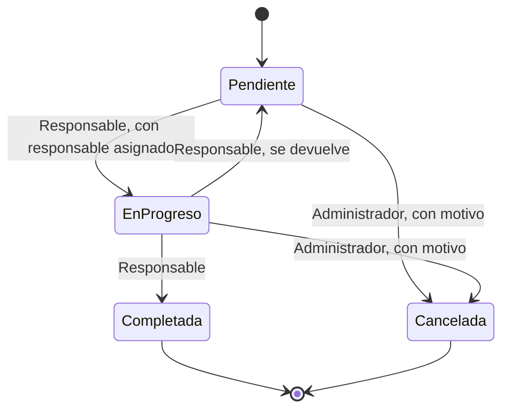

# Máquina de estados de Tarea

La entidad central del módulo de negocio es `Tarea`. Su estado sigue esta máquina, independiente de la de Gestión de permisos del Core (RF-NEG-09): no comparten estados, ni código, ni tablas.

## Estados

Declarados en un solo lugar: `src/GestorTareas.Negocio/Entidades/EstadoTarea.cs` (RF-NEG-03).

| Estado | Significado | ¿Terminal? |
|---|---|---|
| Pendiente | La tarea existe y todavía no se empieza. Es el estado inicial. | No |
| EnProgreso | El responsable está trabajando en la tarea. | No |
| Completada | La tarea se terminó. | **Sí** |
| Cancelada | La tarea se descartó, con un motivo escrito. | **Sí** |

## Transiciones

Declaradas en un solo lugar: `src/GestorTareas.Negocio/Estados/MaquinaEstadosTarea.cs` (RD-04). La única forma de cambiar el estado es `Tarea.CambiarEstado`. Un rechazo devuelve un mensaje y el estado no cambia.

### Transiciones permitidas

| # | Desde | Hacia | Quién la ejecuta | Condición |
|---|---|---|---|---|
| P1 | Pendiente | EnProgreso | Responsable | La tarea tiene responsable asignado. |
| P2 | EnProgreso | Completada | Responsable | — |
| P3 | EnProgreso | Pendiente | Responsable | — (se devuelve sin terminar) |
| P4 | Pendiente | Cancelada | Administrador | Exige un motivo escrito. |
| P5 | EnProgreso | Cancelada | Administrador | Exige un motivo escrito. |

Si quien la pide no es el actor de la columna «Quién la ejecuta», o no se cumple la condición, la transición se rechaza y el estado no cambia.

### Transiciones prohibidas

| # | Desde | Hacia | Por qué se rechaza |
|---|---|---|---|
| X1 | Pendiente | Completada | **Prohibida de forma explícita** (RF-NEG-04): una tarea no se puede completar sin haberse empezado. |
| X2 | Pendiente | Pendiente | No es un cambio de estado. |
| X3 | EnProgreso | EnProgreso | No es un cambio de estado. |
| X4 | Completada | Cualquiera | Estado terminal (RF-NEG-05): ninguna transición parte de él. |
| X5 | Cancelada | Cualquiera | Estado terminal (RF-NEG-05): ninguna transición parte de él. |

Con las cinco permitidas y estas cinco filas quedan cubiertas las 16 combinaciones de origen y destino.

## Diagrama

## Orden en que se validan las reglas

1. Si el estado actual es terminal, se rechaza.
2. Si la transición está en la lista de prohibidas, se rechaza con su motivo.
3. Si no está en la lista de permitidas, se rechaza.
4. Si quien la ejecuta no es el actor de esa transición, se rechaza.
5. `Pendiente → EnProgreso` sin responsable asignado se rechaza.
6. Una cancelación sin motivo se rechaza.

## Pruebas

Cada fila de las dos tablas tiene al menos una prueba en `tests/GestorTareas.Pruebas/Negocio/MaquinaEstadosTareaPruebas.cs`, y el nombre de la prueba empieza con su número de fila (`P1_`, `X1_`…). Las condiciones de las transiciones permitidas tienen pruebas propias que empiezan con `C`. Las pruebas usan la entidad `Tarea` directamente, sin base de datos ni API (RD-12). Se ejecutan con el comando de la sección «Pruebas» del README.